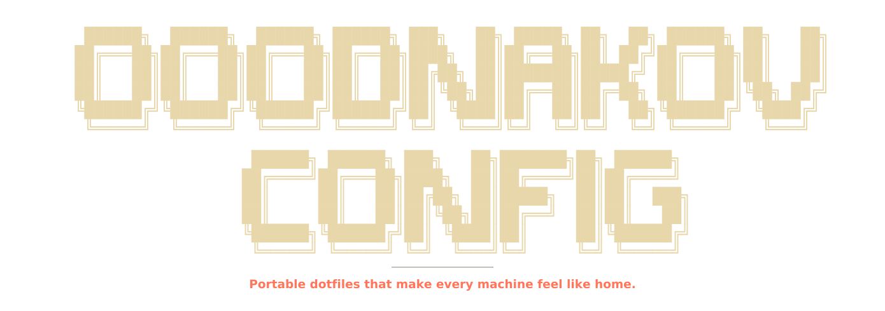

<p align="center">
  
</p>

# ooodnakov-config

Reproducible personal dotfiles for Linux, Windows, and macOS machines, driven by one
CLI (`oooconf`, short alias `o`) for install, updates, and recovery.

This repo tracks the opinionated base config and bootstrap logic only. Secrets, tokens, private keys, and host-specific overrides stay outside git in local files.

The generated [CLI reference](docs/cli-reference.md) lists every public command, option, supported platform, and stable handler ID. Operational examples stay hand-authored: in this README for first install, in [the CLI usage guide](docs/cli-usage.md) for day-to-day commands, and in `oooconf help <command>`.

## What This Repo Manages

Active tracked config lives under `home/` and includes:

- Zsh entrypoints, modular Zsh config, pinned shell helpers, and generated completions
- Git Bash (Windows) support: a pinned MSYS2 zsh package installed into the Git for Windows tree so Git Bash windows run the same managed zsh stack, plus managed `.bashrc`/`.bash_profile` entrypoints that exec into zsh
- shared portable environment files plus ignored local override templates
- WezTerm, Noctty (Windows), Herdr, Yazi, LazyVim/Neovim, LazyGit, LazyDocker, btop, CAVA, todo.txt, Taskwarrior, and ccstatusline config
- PowerShell profile, PowerShell completions, Oh My Posh, and shared SSH include config
- Linux desktop config for Niri, Umbriel, Hyprland/Pyprland, and Noctalia
- Windows window-manager config for Komorebi, GlazeWM, Zebar, and the `.pi` coding agent
- macOS desktop config for AeroSpace, OmniWM, SketchyBar, and Borders
- agent policy, MCP, provider, skill, and installer metadata under `home/.config/ooodnakov/agents/`

Bootstrap and maintenance entrypoints live under `scripts/`, with the public scripts
(`scripts/setup/setup.sh`, `setup.ps1`, `ooodnakov.sh`, `ooodnakov.ps1`) staying
stable and thin while focused implementation modules live in `scripts/setup/lib/`.
`deps.lock.json` pins upstream refs for setup scripts.

Reference-only material lives under `third_party/` and `docs/imports/`. It is stored for auditability and extraction work, not as active config.

### Repo layout

- `home/`: managed config that gets linked into the user profile
- `scripts/`: install, update, doctor, delete, and pin-management commands
- `docs/`: install, usage, architecture, reproducibility, and audit documentation
- `third_party/`: upstream and local reference trees
- `fonts/meslo/`: bundled Meslo Nerd Font files used by the prompt and terminal defaults

<!-- TOC START -->
## Contents

- [What This Repo Manages](#what-this-repo-manages)
  - [Repo layout](#repo-layout)
- [Quick Start](#quick-start)
  - [Preferred install path on Linux or macOS](#preferred-install-path-on-linux-or-macos)
  - [Bootstrap shortcut on Unix-like systems](#bootstrap-shortcut-on-unix-like-systems)
  - [Windows PowerShell](#windows-powershell)
- [Prerequisites](#prerequisites)
- [CLI Entry Points](#cli-entry-points)
- [Documentation](#documentation)
- [CI/CD](#cicd)
- [Development](#development)
<!-- TOC END -->

## Quick Start

### Preferred install path on Linux or macOS

```bash
git clone https://github.com/ooodnakov/ooodnakov-config.git ~/src/ooodnakov-config
cd ~/src/ooodnakov-config
./home/.config/ooodnakov/bin/oooconf install
```

This is the recommended path because it lets you inspect the tracked config and setup scripts before they make changes on the machine.

Before first install, the repo-local `oooconf` script is the intended entrypoint. After install, setup links both `oooconf` and short alias `o` into `~/.local/bin`, so you can run:

```bash
oooconf install
oooconf deps
oooconf update
oooconf dry-run
oooconf doctor
o doctor
```

### Bootstrap shortcut on Unix-like systems

```bash
curl -fsSLo /tmp/ooodnakov-bootstrap.sh https://raw.githubusercontent.com/ooodnakov/ooodnakov-config/main/bootstrap.sh
less /tmp/ooodnakov-bootstrap.sh
bash /tmp/ooodnakov-bootstrap.sh
```

One command for a new machine, no prior clone: sparse checkout plus the minimal
shell profile and the minimal dependency set (`[minimal]` in
`scripts/optional-deps.toml`).

```bash
curl -fsSLo /tmp/ooodnakov-bootstrap.sh https://raw.githubusercontent.com/ooodnakov/ooodnakov-config/main/bootstrap.sh && bash /tmp/ooodnakov-bootstrap.sh minimal --min-dep
```

`minimal` performs the sparse checkout and links the minimal shell profile;
`--min-dep` is an independent flag that installs only the minimal dependency
set. Use `minimal` alone for config without packages, or `--min-dep` alone to
install dependencies without touching managed links. Add `--dry-run` to preview.
`OOODNAKOV_MINIMAL=1` and `OOODNAKOV_SKIP_DEPS=1` are the equivalent environment
forms. The script is intentionally downloaded before execution instead of being
piped into a shell; see [the install guide](docs/install.md) for the manual sparse
checkout, the dependency list, and `SHA256SUMS` release verification.

### Windows PowerShell

```powershell
git clone https://github.com/ooodnakov/ooodnakov-config.git $HOME\src\ooodnakov-config
Set-Location $HOME\src\ooodnakov-config
Set-ExecutionPolicy -Scope Process -ExecutionPolicy Bypass
.\home\.config\ooodnakov\bin\oooconf.ps1 install
```

After setup, `oooconf` is linked into `$HOME\.local\bin` (plus short alias wrappers `o.ps1`/`o.cmd`), and the managed PowerShell profile prepends that directory to `PATH`, so the same commands work in new sessions:

```powershell
oooconf install
oooconf deps
oooconf update
oooconf dry-run
oooconf doctor
o doctor
```

## Prerequisites

The setup scripts intentionally do not try to provision a full workstation from bare metal. Core tools should already exist before first install:

| Platform    | Required System Tools               | Core Terminal Tools     |
| ----------- | ----------------------------------- | ----------------------- |
| **Linux**   | `git`, `zsh`                        | `wezterm`, `oh-my-posh` |
| **macOS**   | `git`, `zsh`                        | `wezterm`, `oh-my-posh` |
| **Windows** | `git`, `pwsh` (for PowerShell Core) | `wezterm`, `oh-my-posh` |

On Windows, `oooconf deps zsh` installs a pinned MSYS2 zsh into the Git for Windows tree so Git Bash windows run the managed shell. The bundled Meslo Nerd Font is installed per-user by setup. Details, Ghostty support, and the full dependency policy are in [the install guide](docs/install.md) and [reproducibility notes](docs/reproducibility.md).

## CLI Entry Points

Primary commands:

- `o`: short alias wrapper for `oooconf` with matching completion behavior
- `oooconf install`: apply managed config and optional dependency installs
- `oooconf deps`: install optional dependencies only, with a multi-select picker when `gum` is available
- `oooconf update`: fast-forward pull the repo, then rerun install; pass `--no-deps` to skip optional dependency installation
- `oooconf dry-run`: preview setup actions without changing the system
- `oooconf doctor`: validate managed links and key tools; `--format text|json` for stable, actionable health checks
- `oooconf status --format text|json`: summarize managed state without mutation
- `oooconf plan`: build a validated, side-effect-free operation plan in text or versioned JSON
- `oooconf apply`: transactionally apply the validated managed-link plan
- `oooconf rollback --last`: safely reverse the latest eligible managed-link transaction
- `oooconf delete`: remove managed links and restore latest backups when available
- `oooconf remove`: remove managed links without restoring backups
- `oooconf bootstrap`: clone/update repo then run install (Unix only)
- `oooconf lock` / `oooconf update-pins`: regenerate or refresh dependency lock artifacts
- `oooconf link`: create or update symlinks from manifest (also runs automatically during install)
- `oooconf completions`: regenerate completion files
- `oooconf snapshot export|inspect|apply`: move allowlisted preferences and capabilities without exporting secrets or host paths

Every remaining command family has a guide of its own:

- secrets, environment, shell preferences, colors, window manager, completions, help, unattended runs, transaction semantics, and profiles: [CLI usage](docs/cli-usage.md)
- agent policy, MCP, provider, and skill synchronization: [Agent policy management](docs/agents.md)
- full option and platform matrix: [generated CLI reference](docs/cli-reference.md)

The helper scripts use `uv` for Python version and dependency management. If `uv` is available, scripts run in the pinned Python environment (defined in `.python-version` and `pyproject.toml`); otherwise they fall back to the system `python3`.

## Documentation

Setup and configuration:

- install behavior, optional dependency catalog, pins, fonts, Windows specifics: [docs/install.md](docs/install.md)
- environment files, local overrides, shell integrations, OMP links, secrets sync: [docs/environment.md](docs/environment.md)
- WezTerm workspace ergonomics and Ghostty: [docs/terminals.md](docs/terminals.md)
- Herdr app layouts, panels, and task/artifact commands: [docs/herdr-app.md](docs/herdr-app.md)
- agent policy, MCP servers, providers, skills: [docs/agents.md](docs/agents.md)

Reference and architecture:

- architecture notes: [docs/architecture.md](docs/architecture.md)
- symlink manifest and local overrides: [docs/symlink-manifest.md](docs/symlink-manifest.md)
- reproducibility notes and platform support matrix: [docs/reproducibility.md](docs/reproducibility.md)
- profiles and capability bundles: [docs/profiles.md](docs/profiles.md)
- snapshots and structured diagnostics: [docs/snapshots-and-diagnostics.md](docs/snapshots-and-diagnostics.md)
- dependency decisions: [docs/dependency-decisions.md](docs/dependency-decisions.md)
- dependency lock artifacts: [docs/dependency-lock.md](docs/dependency-lock.md)
- Docker Engine install (Ubuntu, Arch): [docs/docker-install.md](docs/docker-install.md)
- troubleshooting and recovery: [docs/troubleshooting.md](docs/troubleshooting.md)
- Fleet automation: [docs/fleet-automation.md](docs/fleet-automation.md)
- CI terminal smoke checks: [docs/ci-smoke-checks-terminal.md](docs/ci-smoke-checks-terminal.md)
- CLI extension guide: [docs/cli-extension-guide.md](docs/cli-extension-guide.md)
- agent config model research: [docs/agents-config-research.md](docs/agents-config-research.md)
- import and comparison notes: [docs/imports/upstream-audit.md](docs/imports/upstream-audit.md)
- third-party tree notes: [third_party/README.md](third_party/README.md)

Contributing:

- contributing workflow, pre-commit hooks, and validation: [docs/contributing.md](docs/contributing.md)
- contributor instructions and coding rules: [AGENTS.md](AGENTS.md)

Upstream inspirations: [`jotyGill/ezsh`](https://github.com/jotyGill/ezsh) and [`KevinSilvester/wezterm-config`](https://github.com/KevinSilvester/wezterm-config).

## CI/CD

- CI runs on pushes to `main` and pull requests: Python lint/format, Bash `shellcheck` on Linux and macOS, PowerShell parser validation on Windows, lockfile reproducibility, static Neovim/WezTerm/Ghostty smoke checks, and `oooconf` smoke tests (`install --dry-run`, `doctor` expected-failure on a fresh HOME, and `lock`)
- tags matching `v*` publish `.tar.gz` and `.zip` source archives to GitHub Releases
- the complete plan/apply/doctor/remove/restore/rollback lifecycle runs in isolated temporary homes on Linux, macOS, and Windows with network installs disabled and a ratchetable coverage floor
- Fleet automation is locked and preview-only for merges by default; `oooconf fleet sync` then pulls the result onto SSH hosts (see [Fleet automation](docs/fleet-automation.md))

## Development

Install `pre-commit` and enable the tracked hooks before committing; they mirror the main local checks (Bash syntax, `shellcheck`, Ruff lint/format, dependency lock reproducibility, and a `gitleaks` scan of staged changes).

```bash
uv tool install pre-commit
pre-commit install
pre-commit run --all-files
```

`just` wraps routine tasks (`just check`, `just unix`, `just test`, `just completions`, `just lock`); see [the contributing workflow](docs/contributing.md) for the full list, validation guidance, and CI expectations.
